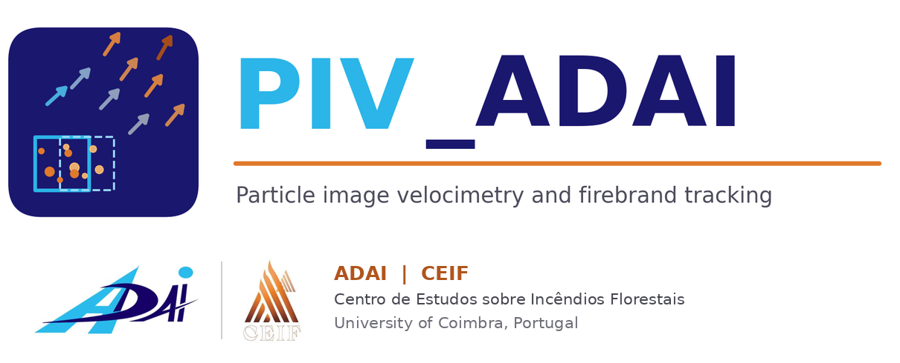

<p align="center"></p>

# PIV_ADAI

**PIV_ADAI** is a MATLAB application with a graphical user interface for the image-based analysis of firebrands and other particles recorded in fire experiments. It detects every firebrand in an image sequence or video, tracks it through time (PTV), computes cross-correlation velocity fields with user-defined interrogation areas (PIV), and post-processes velocity, direction, size, number density and streamlines.

Developed at **ADAI** (Associação para o Desenvolvimento da Aerodinâmica Industrial) and **CEIF** (Centro de Estudos sobre Incêndios Florestais), Department of Mechanical Engineering, University of Coimbra, Portugal.

[](https://doi.org/10.5281/zenodo.XXXXXXX)  <!-- replace after the first Zenodo release -->

## Features

| Stage | Options |
|---|---|
| Input | Whole image folders **or individually selected images** (multi-select), editable image list (filter by file name, keep/remove selected, add images), natural file ordering, video files (AVI, MP4, MOV, ...), frame range and step, fps or dt, spatial calibration (scale or drawn line), rectangular or polygonal ROI |
| Image conditioning | **Automatic** (stretch limits, CLAHE, histogram equalisation) **or manual** brightness, contrast and gamma; colour channel (grey, R, G, B, max RGB); background removal: **per-frame top-hat** for uneven illumination (default) or sequence median/mean/minimum, dark-particle and absolute-difference modes; inversion; median and Gaussian filters; one-click recommended settings |
| Detection | **Robust noise-level threshold** (median + k·MAD, default), Otsu, mean + k·std, manual or adaptive threshold; min/max area; morphological opening; hole filling; border clearing; intensity-weighted sub-pixel centroids; live preview |
| PTV | Nearest-neighbour linking with velocity prediction, gap closing and minimum track length; per-firebrand position, velocity, speed, direction, size, path length |
| PIV | Interrogation areas 16-128 px, 0-75 % overlap, 1-3 passes with window offset, FFT cross-correlation, 3-point Gaussian sub-pixel fit, normalised median test with outlier replacement |
| Post-processing | Detections, trajectories, PTV vectors, instantaneous and time-mean PIV fields, speed maps, streamlines, number-density maps, direction rose, speed and size histograms, count and speed time series, u-v scatter |
| Export | CSV tables, MAT file, JSON settings (reproducibility), 300-dpi figures (PNG/TIFF/PDF), annotated frame sequences |

## Requirements

* MATLAB **R2021a** or newer
* **Image Processing Toolbox**

## Installation and quick start

```matlab
% clone or download the repository, then in MATLAB:
cd PIV_ADAI
PIV_ADAI
```

Recommended workflow (the tabs on the left are numbered in this order):

1. **Input** - load an image folder, pick individual images or load a video; refine the image list with the filename filter or the Keep/Remove buttons, set the frame range, fps (or dt) and calibration, and draw an ROI if needed.
2. **Image** - choose *Automatic* or *Manual* brightness/contrast and the background removal. Keep the top-hat radius larger than the radius of the largest firebrand. Switch the view to *Processed* to check the result.
3. **Detect** - choose the threshold method and size limits; *Preview detection* shows the detected objects on the current frame.
4. **Analyse** - choose Detection only, PTV, PIV or PTV + PIV and set the tracking and interrogation-area parameters (*Show interrogation-area grid* draws the IA layout on the image). Press **RUN ANALYSIS**.
5. **Results** - choose image overlays and statistics plots with the radio buttons, read the summary, and export.

Keyboard: left/right arrows step through frames.

### Test with synthetic data

```matlab
addpath examples
generate_synthetic_firebrands('synthetic_firebrands', 80)
```

This writes 80 frames and `ground_truth.csv` (true positions and velocities). Load the folder, set fps = 1 (so px/s equals px/frame), max displacement 15 px, and compare the exported tables with the ground truth.

## Conventions

* Image coordinates: x to the right, **y downwards** from the top of the image (columns `y_down_*`).
* Velocities: u positive to the right, **v positive upwards** (columns `v_up_*`).
* Direction: 0 deg = +x (right), 90 deg = upwards, counter-clockwise.
* Units: px and px/s when uncalibrated; mm and m/s when calibrated (scale in mm/px).
* Number density: particles per unit area per frame, averaged over the analysed frames.

## Output files (Export CSV)

| File | Content |
|---|---|
| `firebrand_particles.csv` | Every detection: frame, time, track id, position, area, equivalent diameter, axes, orientation, intensity, u, v, speed, direction |
| `firebrand_tracks.csv` | One row per trajectory: duration, path length, net displacement, mean/max speed, mean direction, mean size |
| `firebrand_frame_statistics.csv` | Per frame: object count, mean size, tracked count, mean speed |
| `piv_mean_field.csv` | Time-mean PIV field |
| `piv_instantaneous_fields.csv` | All instantaneous PIV fields |
| `analysis_settings.json` | All settings, reloadable in the GUI |

## Logos

`logo/piv_adai_logo.png` (program logo) and `logo/piv_adai_icon.png` (window icon) belong to PIV_ADAI. The ADAI and CEIF logos (`logo/adai_logo.png`, `logo/ceif_logo.png`) are shown small below the program logo to indicate affiliation and remain the property of their institutions.

## How to cite

Please cite the archived version through its DOI (see `CITATION.cff`, or the "Cite this repository" button on GitHub):

> Modarres, M. (2026). *PIV_ADAI: a MATLAB GUI for image velocimetry and tracking of firebrands and particles* (Version 1.0.0) [Computer software]. Zenodo. https://doi.org/10.5281/zenodo.XXXXXXX

The DOI badge at the top of this page is the *concept DOI*, which always resolves to the latest version.

## Licence

MIT - see [LICENSE](LICENSE).
